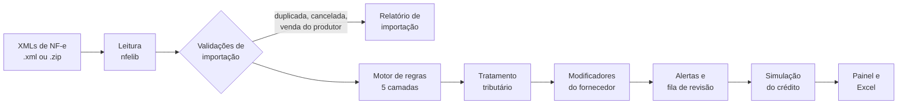

# IAG 5.0 — Diagnóstico de créditos IBS/CBS no agronegócio

Aplicativo web que lê as notas fiscais de compra de um produtor rural, classifica cada item e estima os créditos de **IBS** e **CBS** que ele terá no novo sistema tributário criado pela Reforma Tributária do Consumo (EC 132/2023 e LC 214/2025).

O foco é responder, em poucos minutos, as perguntas que o produtor e o contador vão fazer na transição:

- Quanto das minhas compras vai gerar crédito?
- Quanto não gera crédito, e por quê?
- Quais notas têm problemas que podem me fazer perder créditos?


> **Aviso.** Este é um protótipo. As regras tributárias estão na **versão 1, em rascunho**, pendentes de revisão por especialista. O resultado é uma estimativa de apoio à decisão e **não substitui a análise do contador nem parecer jurídico**. Na versão de demonstração, use apenas notas fictícias.

---

## Sumário

- [Contexto](#contexto)
- [Funcionalidades](#funcionalidades)
- [Como funciona](#como-funciona)
- [O ponto central: insumos com diferimento](#o-ponto-central-insumos-com-diferimento)
- [Instalação](#instalação)
- [Como usar](#como-usar)
- [Testes](#testes)
- [Estrutura do projeto](#estrutura-do-projeto)
- [Manutenção das regras](#manutenção-das-regras)
- [Publicação no Streamlit Community Cloud](#publicação-no-streamlit-community-cloud)
- [Privacidade e segurança](#privacidade-e-segurança)
- [Identidade visual](#identidade-visual)
- [Limitações e próximos passos](#limitações-e-próximos-passos)
- [Base legal](#base-legal)
- [Bibliotecas e licenças](#bibliotecas-e-licenças)
- [Autoria](#autoria)

---

## Contexto

O projeto nasceu do artigo tecnológico *IAG 5.0 — Inteligência Artificial para Gestão Tributária do Agronegócio*, desenvolvido no Doutorado Profissional da FUCAPE com a abordagem de *design science research*.

Com o IVA dual (CBS federal e IBS estadual e municipal), o crédito tributário passa a depender da qualidade da informação: compras sem nota adequada, com descrição genérica ou com o código tributário errado viram crédito perdido. Produtores rurais com receita acima de R$ 3,6 milhões por ano serão contribuintes do novo sistema e precisam conhecer esse impacto antes que ele chegue ao caixa.

O público principal são **escritórios contábeis que atendem produtores rurais**: o contador envia os XMLs, revisa o que o sistema aponta e entrega o diagnóstico ao cliente.

## Funcionalidades

- **Leitura de NF-e** (modelo 55) em arquivos `.xml` soltos ou em `.zip`, com a biblioteca [nfelib](https://github.com/akretion/nfelib), incluindo o novo grupo de IBS/CBS (CST e cClassTrib).
- **Tratamento de duplicatas, cancelamentos e vendas:** a mesma nota enviada duas vezes é contada uma vez; notas com evento de cancelamento saem do cálculo; notas emitidas pelo próprio produtor são separadas.
- **Validação opcional contra o schema oficial** da NF-e.
- **Classificação de cada item** em 33 categorias, por 67 regras organizadas em cinco camadas (operação, vedações, NCM, fornecedor e descrição).
- **Tratamento tributário** de cada item conforme a LC 214/2025: alíquota padrão, insumos do Anexo IX com diferimento, produtos in natura, combustíveis monofásicos, uso pessoal.
- **Ajuste pelo regime do fornecedor:** Simples Nacional e produtor rural pessoa física.
- **Conferência do cClassTrib** informado pelo fornecedor contra o esperado para cada tratamento.
- **Fila de revisão** ordenada por valor, com o motivo de cada alerta e a regra que decidiu.
- **Simulação do crédito** com parâmetros ajustáveis: alíquota de referência, crédito do diesel por litro, percentual do Simples e crédito presumido.
- **Consulta opcional do CNAE do fornecedor** pela [BrasilAPI](https://brasilapi.com.br), com cache.
- **Exportação para Excel** com resumo, itens e ocorrências da importação.

## Como funciona



Para cada item de cada nota, o motor toma três decisões:

1. **Categoria:** o que é o item (fertilizante, diesel, trator, cerveja...).
2. **Tratamento:** qual regime de IBS/CBS se aplica.
3. **Efeito no crédito:** crédito integral, sem crédito por diferimento, crédito por litro, crédito limitado, crédito presumido, vedado, neutro ou "depende de revisão".

As cinco camadas de classificação, da evidência mais forte para a mais fraca:

| Camada | Base | Exemplo |
|---|---|---|
| 1. Operação | CFOP do emitente | Remessa para conserto e simples faturamento de entrega futura não são compras |
| 2. Vedações | NCM e descrição (art. 57) | Bebidas alcoólicas, tabaco, joias e armas: crédito vedado |
| 3. NCM | Prefixo de NCM (o mais longo vence) | Capítulo 31 é fertilizante, mas cimento (2523) não é corretivo de solo |
| 4. Fornecedor | CNAE do emitente | Compra em supermercado vai para revisão |
| 5. Descrição | Palavras-chave | "SEMENTE", "RAÇÃO", "OLEO DIESEL" quando o NCM não decide |

Todas as regras ficam em arquivos YAML, separados do código, e cada resultado informa qual regra decidiu e por quê.

## O ponto central: insumos com diferimento

Pelo art. 138 da LC 214/2025, os insumos agropecuários do Anexo IX (fertilizantes, defensivos, sementes, rações, medicamentos veterinários e outros) têm alíquota reduzida em 60% e, quando vendidos por fornecedor do regime regular a produtor contribuinte, **recolhimento diferido**.

Na prática, a nota de compra do adubo não traz imposto destacado: o produtor **não toma crédito** sobre ele, e o preço também não carrega IBS/CBS. Um cálculo que aplicasse a alíquota sobre todas as compras mostraria créditos que não existem. O aplicativo separa esses valores e mostra o tamanho desse erro.

## Instalação

Requisito: **Python 3.10 ou superior** (testado com 3.12 e 3.13).

```bash
git clone https://github.com/<seu-usuario>/<seu-repositorio>.git
cd <seu-repositorio>

python -m venv .venv
# Windows (PowerShell)
.venv\Scripts\Activate.ps1
# macOS / Linux
source .venv/bin/activate

python -m pip install -r requirements-dev.txt
```

## Como usar

Inicie o aplicativo:

```bash
python -m streamlit run app.py
```

O navegador abre em `http://localhost:8501`. Para uma primeira demonstração:

1. Clique em **Usar notas de exemplo**. O app carrega notas fictícias e preenche o produtor de exemplo.
2. Veja os indicadores, a aba **Para revisar** e a aba **Importação**.
3. Clique em **Baixar resultado em Excel**.

Para testar com uma nota completa, no leiaute oficial e com o grupo IBS/CBS preenchido, use `docs/nfe_teste_iag50.xml`. Informe o CPF fictício `529.982.247-25` na barra lateral e envie o arquivo. O resultado esperado é de 14 itens, R$ 339.600,00 em insumos com diferimento, R$ 4.654,80 de crédito estimado (com alíquota de 27%) e 5 itens para revisar.

Na barra lateral, ajuste:

- **Produtor:** nome, CPF ou CNPJ e inscrições estaduais. As notas destinadas a outro documento recebem alerta.
- **Cenário:** alíquota de referência (27% no cenário base) e os parâmetros de crédito ainda não definidos pela regulamentação. Parâmetro zerado significa "não estimar", e o app não inventa valores.
- **Opções:** validação contra o schema oficial e consulta de CNAE na BrasilAPI.

> O app precisa ser iniciado pelo Streamlit. Se for aberto com `python app.py` ou pelo botão de executar do VS Code, ele se reinicia sozinho do jeito certo.

## Testes

```bash
python -m pytest
```

São 51 testes automatizados:

| Arquivo | O que testa |
|---|---|
| `tests/test_motor.py` | Os 34 casos de `casos_teste_v1.yaml`, a conferência do cClassTrib e o cálculo do crédito, inclusive com dados incompletos |
| `tests/test_leitor.py` | Leitura das notas de exemplo, campos de IBS/CBS, arquivo `.zip`, XML malformado e bloqueio de entidades externas |
| `tests/test_regras.py` | Validação dos arquivos de regras: regex inválida, confiança fora do intervalo, regra sem condição, campo desconhecido |
| `tests/test_fornecedores.py` | Consulta de CNPJ com cache, sem acessar a internet (resposta simulada) |
| `tests/test_app.py` | Abertura do app, carga das notas de exemplo e exibição dos indicadores |

O motor também pode ser testado sozinho, com `python motor_regras.py --mostrar`.

## Estrutura do projeto

```
.
├── app.py                          # interface web (Streamlit)
├── leitor_nfe.py                   # leitura de XML de NF-e (nfelib, lxml)
├── motor_regras.py                 # classificação, tratamento e estimativa de crédito
├── modelos.py                      # validação dos arquivos de regras (pydantic)
├── fornecedores.py                 # CNAE do fornecedor pela BrasilAPI, com cache
├── regras_classificacao_v1.yaml    # taxonomia, abreviações, 67 regras e validações
├── tratamento_tributario_v1.yaml   # tratamentos T00–T07, NCM × categoria, vendas
├── casos_teste_v1.yaml             # 34 casos de teste do motor
├── gerar_planilha.py               # gera a planilha de revisão para especialistas
├── IAG50_tratamento_tributario_e_regras_v1.xlsx
├── requirements.txt                # dependências do app
├── requirements-dev.txt            # dependências do app + pytest
├── .streamlit/config.toml          # tema visual e configurações do servidor
├── assets/                         # logotipo
├── static/                         # fonte Roboto (servida pelo próprio app)
├── exemplos/                       # notas fictícias e simplificadas para demonstração
├── docs/                           # imagem da tela e nota de teste completa
└── tests/                          # testes automatizados (pytest)
```

## Manutenção das regras

As regras ficam nos arquivos YAML e podem ser alteradas sem mexer no código Python. O fluxo recomendado para cada mudança:

1. O especialista tributário revisa a planilha `IAG50_tratamento_tributario_e_regras_v1.xlsx` (colunas de status, revisor, data e comentário).
2. O ajuste aprovado é lançado no YAML correspondente, com nova versão.
3. Um caso de teste novo é acrescentado em `casos_teste_v1.yaml`.
4. `python -m pytest` precisa passar 100% antes da publicação.

Ao carregar os YAMLs, o `modelos.py` recusa regras mal escritas (regex inválida, categoria inexistente, campo com nome errado, tratamento não definido). Um erro aparece na hora da carga, e não como resultado errado no relatório.

Para regerar a planilha de revisão depois de alterar os YAMLs:

```bash
python gerar_planilha.py
```

**Atenção:** o Anexo IX é revisado periodicamente (art. 138, § 10), e a regulamentação da reforma ainda está em andamento. A tabela de tratamento precisa de acompanhamento contínuo.

## Publicação no Streamlit Community Cloud

1. Envie este repositório para o GitHub (de preferência **privado**).
2. Acesse [share.streamlit.io](https://share.streamlit.io) e entre com a conta do GitHub.
3. Crie um app apontando para este repositório, branch `main`, arquivo `app.py`, e escolha Python 3.12 nas configurações avançadas.
4. Em **Share**, convide as pessoas por e-mail. Um repositório privado gera um app privado.

Cada novo envio ao GitHub atualiza o app publicado.

## Privacidade e segurança

- Os XMLs são processados **em memória** e não são gravados em disco.
- O leitor de XML **bloqueia entidades externas** e acesso à rede, o que impede ataques do tipo XXE, e limita o tamanho dos arquivos e a quantidade de XMLs por `.zip`.
- A consulta à BrasilAPI é **opcional**, envia **apenas CNPJs** de fornecedores (dados cadastrais públicos) e **nunca envia CPF**.
- A fonte é servida pelo próprio app, sem requisições ao Google Fonts.
- O `.gitignore` impede o envio de caches e de uma pasta `notas_reais/`. Guarde notas de clientes sempre nessa pasta, fora do controle de versão.

Notas fiscais contêm dados pessoais protegidos pela LGPD (CPF, nome, endereço e valores). **Para uso com dados reais**, publique o app em hospedagem com login, HTTPS, separação de dados por escritório e, de preferência, servidores no Brasil, com contrato que defina os papéis de controlador e operador.

## Identidade visual

O tema segue o Manual da Marca OBDC (2026):

| Elemento | Aplicação |
|---|---|
| Verde `#009490` | Títulos, botões, seleções e valores dos indicadores |
| Amarelo `#FFC600` | Filetes e faixas de destaque (nunca como cor de texto, por contraste) |
| Cinza `#EBEBEB` | Barra lateral, cartões e cabeçalhos de tabela |
| Roboto | Black/ExtraBold em títulos, Bold em subtítulos, Regular no texto |

O arquivo `assets/logo_obdc_provisorio.png` é um recorte do manual. Coloque o logotipo oficial em `assets/logo_obdc.png` e o símbolo em `assets/isotipo_obdc.png` para que o app passe a usá-los automaticamente.

## Limitações e próximos passos

A versão atual **não faz**:

- simulação da transição de 2026 a 2033 (o cálculo é feito no regime pleno);
- cálculo do débito das vendas (as regras estão documentadas no YAML, mas ainda não entram no cálculo);
- leitura de CT-e (fretes), NFS-e (serviços) e contas de energia;
- conferência da assinatura digital e da situação da nota na SEFAZ;
- regras específicas de apropriação de crédito do imobilizado e rateio entre atividades;
- registro das correções do contador dentro do próprio app.

Próximos passos previstos: revisão das regras por especialista, piloto com escritórios contábeis, contas por escritório com histórico, relatório em PDF, edição de regras pela interface e baixa automática das notas pelo serviço de Distribuição de DF-e.

## Base legal

Principais dispositivos da LC 214/2025 usados pelas regras:

| Dispositivo | Assunto |
|---|---|
| Art. 47 | Não cumulatividade e apropriação de créditos |
| Art. 57 | Bens e serviços de uso ou consumo pessoal (crédito vedado) |
| Art. 125 e Anexo I | Cesta Básica Nacional (alíquota zero) |
| Art. 137 | Produtos agropecuários in natura (redução de 60%) |
| Art. 138 e Anexo IX | Insumos agropecuários (redução de 60% e diferimento) |
| Art. 148 e Anexo XV | Hortícolas, frutas e ovos (alíquota zero) |
| Arts. 164 a 168 | Produtor rural não contribuinte e crédito presumido |
| Arts. 172 a 180 | Regime específico de combustíveis |

## Bibliotecas e licenças

| Biblioteca | Uso | Licença |
|---|---|---|
| [Streamlit](https://streamlit.io) | Interface web | Apache-2.0 |
| [nfelib](https://github.com/akretion/nfelib) | Leitura e schemas da NF-e | MIT |
| [lxml](https://lxml.de) | Leitura segura de XML e validação de schema | BSD-3-Clause |
| [pandas](https://pandas.pydata.org) | Tabelas de dados | BSD-3-Clause |
| [pydantic](https://docs.pydantic.dev) | Validação das regras | MIT |
| [PyYAML](https://pyyaml.org) | Leitura dos arquivos de regras | MIT |
| [openpyxl](https://openpyxl.readthedocs.io) | Geração de Excel | MIT |
| [validate-docbr](https://github.com/alvarofpp/validate-docbr) | Validação de CPF e CNPJ | MIT |
| [requests](https://requests.readthedocs.io) | Consulta à BrasilAPI | Apache-2.0 |
| [pytest](https://pytest.org) | Testes automatizados | MIT |
| [Roboto](https://github.com/googlefonts/roboto-classic) | Fonte da interface | SIL Open Font License 1.1 (`static/OFL-Roboto.txt`) |

